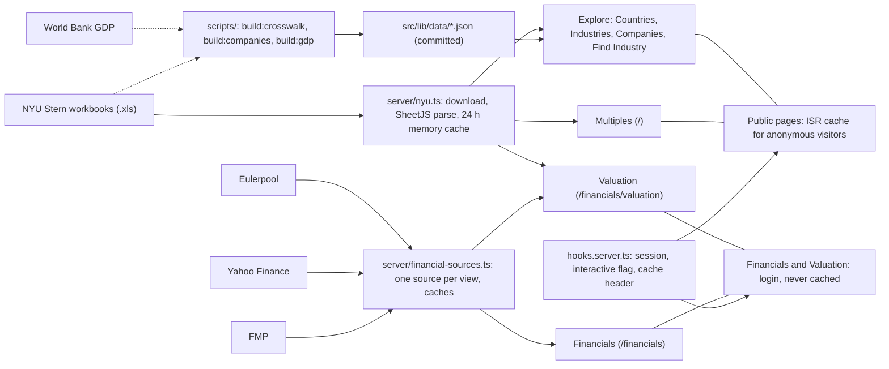

# my-svelte-app

A [SvelteKit](https://svelte.dev/docs/kit) app for comparing valuation multiples from the [NYU Stern](https://pages.stern.nyu.edu/~adamodar/New_Home_Page/data.html) industry datasets. It is deployed on Vercel.

## What it does

Pick 1-4 multiples, 1-4 regions and 1-4 industries on the home page and the app draws grouped bar charts:

- **Multiples:** EV/EBITDA, EV/EBIT, P/E (trailing, forward, current), P/B, EV/Invested Capital, P/S, EV/Sales.
- **Regions:** US, Europe, Global, Japan, India, China, Emerging Markets, Australia/NZ/Canada.
- **Industries:** the 94 NYU industries plus the 2 market-wide total rows.

By default each multiple gets its own panel, industries run along the x axis and regions are the colours. The *Chart layout* dropdowns let you swap those roles. Bars based on fewer than 10 firms are hatched, missing values show as "n/a", and *Show data* lists the exact numbers.

Every selection is stored in the URL, so a view can be bookmarked or shared, for example `/?m=pe_trailing&m=pbv&r=us&r=europe&i=Steel&i=Total+Market`. Parameters: `m` multiples, `r` regions, `i` industry names (repeat a parameter for each value), and `p`, `x`, `c` for the panel, x-axis and colour roles.

### Industry classification

The `/classification` page links Dutch and international industry codes to the NYU Stern industries, in both directions:

- **Code to industry:** search an SBI 2025 code (Standaard Bedrijfsindeling, used by CBS) or words from its title. The page follows it through NACE Rev. 2.1, NACE Rev. 2, ISIC Rev. 4, ISIC Rev. 3.1, NAICS 2002 and SIC 1987 to the Damodaran industries, with company counts and shares.
- **Industry to code:** pick a Damodaran industry and see which SBI 2025 classes match it, ranked by share.

Every step maps one code to several, so the result is a rough guide, not an official mapping. The page explains the abbreviations, and `docs/crosswalk.md` lists the sources and the approximations.

The data for the classification page is generated by `scripts/build-crosswalk.ts` from official correspondence tables (CBS, UN, US Census) and the NYU company list, and committed as `src/lib/data/crosswalk.json`. See `docs/crosswalk.md` to rebuild it.

### Companies

The `/companies` page lists the companies behind an industry. Filter by Damodaran industry, region, sector, SIC code, country and name or ticker (50 per page); the filters live in the URL. Clicking an industry, sector, region or country in the table narrows the list to it, *Reset filters* clears them all, and each row has a *multiples* link to that industry's valuation multiples on the home page. The status line shows how many companies match and how many industries, sectors, regions, sub groups and exchanges they span. The data also holds NYU's Primary Sector (a column and filter) and Sub Group (counted in the status line). The classification page links to it from each industry and each SIC code. The industry shown for a company is the one NYU assigns, not one derived here. The list is built from the NYU company list by `scripts/build-companies.ts` into `src/lib/data/companies.json` (see `docs/crosswalk.md`). US companies on NASDAQ, NYSE or NYSE American link to FMP; other companies whose ticker maps to a Yahoo symbol link to Yahoo Finance (`/financials?symbol=ABN.AS&source=yahoo`). US OTC rows have no button (non-US rows with an OTC ticker still link to Yahoo); logged-out visitors see the login form and land on that ticker after logging in. Share classes are converted to the FMP style (`BRK.B` becomes `BRK-B`).

### Countries and industries

`/countries` and `/industries` show how large each country or industry is as a share of the global total, as a hand-drawn SVG treemap plus ranked bars with a "rest of world" remainder. Countries can be measured in listed companies or in GDP; industries (coloured by sector) and sectors only in companies, never in dollars. Percentages are always of the global total (all 48,156 companies, or World Bank world GDP). Picking a country shows its industries, picking an industry shows its countries, and one country plus one industry shows the cell with a link to the matching `/companies` list. Anonymous visitors see the cached default view; the drill-down (`measure`, `country`, `industry`, `sector`) needs the login. GDP comes from the World Bank (`npm run build:gdp`, once a year, see `docs/size.md`). There is deliberately no company level until there is a value per company.

### Financial statements (`/financials`)

The password-protected `/financials` page shows the annual income statement, balance sheet and cash flow statement for the last 5 fiscal years of a company, looked up by ticker (for example `AAPL` or `ABN.AS`). The data comes from [Financial Modeling Prep](https://site.financialmodelingprep.com) (FMP), Yahoo Finance or [Eulerpool](https://eulerpool.com). Each view uses one data source: FMP for US tickers (the default) or Yahoo Finance (a switch on the page, and the default for tickers with an exchange suffix such as ABN.AS). Eulerpool is never chosen automatically: pick it with the switch (`source=eulerpool`) and it serves any ticker, US or not. It offers annual statements, the company profile, daily prices and the Supply chain tab; its News, Ratios, Estimates, Earnings and Peers tabs say so, and TTM is not offered (its trailing figures mix units). Its statements include analyst forecasts, which are left out, and some years have two rows a few days apart (such as 27 and 30 September), of which the fuller one is kept. Prices are approximated from daily quotes and can differ slightly from the official close, and there is no volume. Check its figures before relying on them: its totals are summed from components and can be incomplete or inconsistent, mostly in the newest year (Toyota's 2026 total assets, ASML's 2025 totals), and its EPS is net income over average shares, not the reported EPS. Yahoo data comes from the unofficial yahoo-finance2 package, may be delayed and can break without notice. TTM is not available with FMP on the current plan and is grayed out there; it works with Yahoo. The page is server-rendered and works without JavaScript.

It needs four environment variables, plus one optional one:

- `FMP_API_KEY`: your FMP key.
- `EULERPOOL_API_KEY` (optional): your Eulerpool key; without it the Eulerpool source says it is not configured.
- `SITE_PASSWORD`: the shared password you give to the people who may use the page.
- `SESSION_SECRET`: signs the login cookie. Generate one with `openssl rand -base64 32`.
- `ISR_BYPASS_TOKEN`: random string of at least 32 characters (`openssl rand -hex 32`). It makes the public pages (Multiples, Countries, Industries, Companies, Find industry, About) a cached static copy (Vercel ISR, one day) for anonymous visitors; logging in sets a cookie that skips the cache. Unset or shorter than 32 characters turns the cache off: the site still works, but it is simply uncached (the pages are sent `private, no-store`, so the CDN does not cache them either, and logging in changes nothing about caching). Set it for Production and Preview. The token is read at build time (the ISR config) and at runtime (the cookie check), so build and runtime must see the same value; redeploy after changing it. The token is also Vercel's revalidation secret, and logout does not invalidate an existing cookie value: to revoke every bypass cookie, rotate `ISR_BYPASS_TOKEN` and redeploy, ideally together with a `SITE_PASSWORD` change. Vercel drops every query parameter that is not listed in the ISR `allowQuery`, even for logged-in requests that skip the cache, so `allowQuery` (`ISR_ALLOW_QUERY` in `src/lib/server/access.ts`) lists every parameter the pages read plus SvelteKit's two data-request parameters. Each value of a listed parameter is cached separately (anonymous pages ignore them, so each entry is the same default view); a bot that varies those values can create extra cache entries and function runs, but the anonymous pages no longer link to any query variant. When a page starts reading a new query parameter, add it to `ISR_ALLOW_QUERY`; a test checks that `SIZE_PARAMS` in `size-nav.ts` is covered.

On Vercel, add them as shared (team-level) variables and link them to the project for Production and Preview. Locally, put them in a `.env` file (see `.env.example`; `.env` is gitignored). They are declared in `src/env.ts` and read on the server only through `$app/env/private`, so a new variable must be added to `src/env.ts` first. If `SITE_PASSWORD` or `SESSION_SECRET` is unset, nobody can log in.

Login sets a signed, HTTP-only cookie that lasts 7 days and applies to the whole site (path `/`); when `ISR_BYPASS_TOKEN` is usable, a second cookie, `__prerender_bypass`, is set with it. Logging out only clears the cookie in that browser; a copied cookie stays valid until it expires. To log everyone out, change `SESSION_SECRET`; to stop new logins with the old password, change `SITE_PASSWORD`. Failed logins are rate limited per IP, best effort only, because the counter lives in each serverless instance. When testing the login with `curl`, send `Accept: text/html`, or SvelteKit answers form actions with JSON.

`/financials` is never cached publicly (`Cache-Control: private, no-store`). Limits: one shared password cannot tell users apart or revoke one person; which tickers work depends on your FMP plan (unsupported ones get a message); FMP's terms may restrict sharing its data; Yahoo's terms target personal use, and Eulerpool's free tier is for personal, non-commercial use and asks for a "Data by Eulerpool" credit wherever its data is shown publicly (the page carries one when Eulerpool is the source; its terms do not say whether the free tier may cache, and the app caches in memory per instance), so check all three before giving anyone the password and do not redistribute the data.

The page has a vertical "Company" menu with the tabs Financials, Ratios, Estimates, Earnings, Peers (these four are FMP only; the tab says so for another source), Supply chain, News, Stock Price and Company Data, and a last entry, Valuation, that opens the valuation page for the same ticker. Under Financials there are tabs for the income statement, balance sheet and cash flow statement plus a Latest 5 years / TTM toggle. The choices live in the URL (`tab`, `statement`, `period`, next to `symbol`), so a view can be bookmarked or shared. Supply chain (marked "test" in the tab and on the page: an experiment that may change or go away; Eulerpool only; the tab says so for any other source) lists the companies Eulerpool links to the ticker as suppliers, customers or both, by name, with country, industry and two share-price correlations, and links each to its own financials. Treat it as a list of leads: it holds genuine suppliers and customers (for Apple, Hon Hai, Broadcom, Qualcomm, Best Buy, T-Mobile) next to unrelated companies, misses real ones (TSMC, Micron, Nvidia), gives no size for any relationship, and its correlations do not separate the real ones from the rest, so it is not ranked. It covers few companies outside the US (ASML.AS has none). Company Data shows the company profile from the active source (cached 24 h) and News the latest 20 articles for the ticker (cached 15 min); links to articles and websites open in a new tab and only http(s) URLs are linked. Stock Price shows the last close, day change, 52-week high and low and volume (end-of-day, not live) with a line chart of the last year of daily closes, from one call to the active source, cached for 1 h. TTM is only available with Yahoo (grayed out with FMP); the TTM balance sheet is the latest annual balance sheet. News on Yahoo is matched by company name and is looser than FMP's.

### Valuation versus peers (`/financials/valuation`)

The valuation page values one company with multiples, the way the football-field slides in a valuation report do. It sits under `/financials`, so it uses the same password and is never cached publicly, and it shows the same "Company" menu, so switching between a company's tabs and its valuation keeps the ticker.

- **Company:** a listed ticker (figures from FMP or Yahoo, the same source rules as `/financials`; forward multiples use FMP analyst estimates) or a private company uploaded from an Excel template. *Download the template* gives an .xlsx with Company, Currency, Net debt, a Year row, a Type row (Actual or Forecast) and one row per figure (Revenue, EBITDA, EBIT, Net income, Book equity, Invested capital). Labels may also be Dutch (Omzet, Eigen vermogen, Realisatie, Prognose). The file is read once and never stored; its figures travel in the page URL (`co`), so they end up in the browser history and the server's request logs.
- **Peers:** picked by hand, up to 8. FMP's peer list is only offered as suggestions. A peer's multiples are computed from its market cap, net debt and figures, so Yahoo peers (tickers with a dot) work too.
- **Eulerpool's view:** when `EULERPOOL_API_KEY` is set, a listed company also gets a panel with Eulerpool's fair value per share (income, revenue and dividend based, against the last price) and its AAQS quality score (1 to 10) with the figures behind it. It is Eulerpool's own model and its method is not published, so the panel is labelled as such, carries the "Data by Eulerpool" credit, and does not feed the calculation: the figures and peers still come from one source. Amounts are in the currency Eulerpool prices the listing in, which can differ from the company's reporting currency (HSBA.L is in USD). The score is built for operating companies and says little about banks. Both are cached for a day per ticker (three Eulerpool calls the first time). A failure or a missing part shows a message and never hides the valuation. A private company, or a deployment without the key, shows no panel.
- **Multiples:** up to 4 from the same list as the home page.
- **Sector:** a Damodaran region and industry, whose value is shown as a separate row and marker.

The page shows the company's figures, a table of each peer's multiples with the peers' 25th percentile, median, 75th percentile and the sector value, a football-field chart and a table of equity values. Each method's range is the company figure times the peers' P25 to P75 (the median is the midpoint), minus net debt for EV multiples. *Manual bands* replace the peer range with a low and high multiple you type in (for example 3x to 5x). The average line is the mean of the midpoints. Values are in the company's own currency, and zero or negative multiples are left out of the percentiles.

All choices live in the URL: `symbol` or `co`, `peer` (repeated), `m` (repeated), `region`, `industry`, `lo.<multiple>` and `hi.<multiple>`, and `source`. A DCF valuation is planned as a separate page.

### Public and logged-in

Anonymous visitors see the default view of Multiples, Countries, Industries, Companies (the first 20 companies), Find industry and About, cached for a day. They cannot use filters, search or paging; the URL parameters are ignored. The same shared password unlocks interactive versions of every page. `/financials` is unchanged. `robots.txt` disallows crawlers.

### Look and navigation

The look follows SAP's Horizon theme. The colours, spacing, shadows, focus ring and shell bar come from Figma exports in `design/horizon/`: `npm run build:tokens` turns them into CSS custom properties in `src/lib/styles/generated/`, and a short list of our own names (`ALIASES`, `ADOPTED` in `src/lib/tokens-tables.ts`) reads them. The Home page is laid out on Horizon's 4/8/12/16-column grid (`src/lib/styles/grid.css`). `docs/horizon-tokens.md` explains how it works and what is not on Horizon yet.

The menubar at the top links the five pages. Three groups of pages have a vertical menu beside the content: Explore (Countries, Industries, Companies, Find Industry), Company (the `/financials` tabs and Valuation) and About ("On this page", anchor links to its sections). Multiples has none: its controls already sit above the chart. Icons are small inline SVGs (`src/lib/icons.ts`, `Icon.svelte`) that follow the text colour.

## How it works



The diagram shows where each page gets its data. The public pages are cached for anonymous visitors; Financials and Valuation need the password and are never cached.

NYU publishes the data as legacy `.xls` workbooks, one per multiple family and region (32 files, updated about once a year). The server downloads only the files a view needs, parses them with [SheetJS](https://sheetjs.com), and keeps them in memory for 24 hours. The public pages are cached by Vercel ISR for one day (when `ISR_BYPASS_TOKEN` is set). If NYU is unreachable, a previously cached copy is served. A January update can take up to about two days to show on the public pages (24 h in-memory + 24 h ISR); logged-in visitors only wait for the in-memory copy.

## Tech stack

- [SvelteKit](https://svelte.dev/docs/kit) 3 with [Svelte](https://svelte.dev) 5 (runes)
- [Vite](https://vite.dev) 8 and TypeScript 6
- [Vitest](https://vitest.dev) for tests
- [`@sveltejs/adapter-vercel`](https://svelte.dev/docs/kit/adapter-vercel) for deployment
- [Playwright](https://playwright.dev) for the browser tests (`npm run test:e2e`, with axe accessibility checks), [ESLint](https://eslint.org) with typescript-eslint and [Prettier](https://prettier.io) for lint and format, [TypeDoc](https://typedoc.org) for the API reference (`npm run docs`)
- SAP Horizon design tokens, exported from Figma (see "Look and navigation")
- SheetJS `xlsx` 0.20.3, installed from `https://cdn.sheetjs.com` (the npm registry copy is unmaintained). Dependabot cannot update it; check for new releases now and then.

## Security

Pages are served with a Content-Security-Policy (script hashes, no framing, same-origin forms) and the headers `X-Content-Type-Options`, `Referrer-Policy` and `Permissions-Policy`, set in `vite.config.ts` (CSP) and `src/hooks.server.ts`. The NYU download is limited to 5 MB per workbook and has a 10 s timeout, URL parameters are checked against allow-lists, and the CI workflow runs with read-only permissions.

## Conventions

The code is TypeScript only (`.ts` files and `<script lang="ts">`), type-checked in strict mode. `npm run check`, `npm run lint`, `npm run format:check` and `npm run check:ts-only` run in CI. The same rules for contributors and agents are in `AGENTS.md` (`CLAUDE.md` is a symlink to it, for tools that look for that name).

CI also enforces a coverage floor on `src/lib` (`npm run test:coverage`), runs the browser tests (`npm run test:e2e`: every page must load without page errors, CSP blocks or serious axe violations) and runs `npm audit --omit=dev --audit-level=high` on runtime dependencies. A separate, non-required `lighthouse` job audits the public pages (home, classification, companies, countries, industries, about) on the production build with Lighthouse CI (`lighthouserc.json`): accessibility, best practices and SEO must score at least 0.9 for the job to pass, performance at least 0.8 as a warning. The `is-crawlable` audit is skipped (`skipAudits` in `lighthouserc.json`) because `robots.txt` deliberately disallows all crawlers, which would otherwise fail the SEO score.

## Releases and design docs

[`docs/overview.md`](docs/overview.md) gives the design at a glance, the design decisions, the release history, the quality review and the roadmap. [`docs/svelte-mcp.md`](docs/svelte-mcp.md) sets up the Svelte MCP server for Claude Code, OpenCode and Pi. [`docs/financials.md`](docs/financials.md) explains the `/financials` sources, Eulerpool and the valuation page, and [`docs/horizon-tokens.md`](docs/horizon-tokens.md) the design tokens. The decisions are recorded one per file in [`docs/adr/`](docs/adr/README.md), the quality review is in [`docs/quality/`](docs/quality/README.md), and [`CHANGELOG.md`](CHANGELOG.md) lists what each release brought. [`RELEASING.md`](RELEASING.md) describes how a release is cut (CalVer `YYYY.0M.0D` tags).

## Getting started

Prerequisites: [Node.js](https://nodejs.org) 24.x (pinned in `package.json` under `engines`, and in `.nvmrc`, so `nvm use` picks it) and npm. The project stays on one Node LTS line; moving to the next one means changing `engines`, `.nvmrc`, the CI workflows and `@types/node` together (a test checks they agree).

```sh
git clone https://github.com/jan-ru/my-svelte-app.git
cd my-svelte-app
npm install
npm run dev
```

The dev server runs at <http://localhost:5173>.

## Scripts

| Command                                       | Description                                                                       |
| --------------------------------------------- | --------------------------------------------------------------------------------- |
| `npm run dev`                                 | Start the Vite dev server                                                         |
| `npm run build`                               | Create a production build                                                         |
| `npm run preview`                             | Preview the production build locally                                              |
| `npm test`                                    | Run the unit tests (no network)                                                   |
| `npm run test:coverage`                       | Run the tests with a coverage report; fails below the floor in `vitest.config.ts` |
| `npm run test:e2e`                            | Browser tests with Playwright; run `npm run build` first                          |
| `npm run check`                               | Type-check the code with svelte-check (strict)                                    |
| `npm run lint`                                | ESLint (typescript-eslint strict, eslint-plugin-svelte)                           |
| `npm run format` / `format:check`             | Prettier: rewrite the files, or only check them                                   |
| `npm run check:ts-only`                       | Fail if the repository contains JavaScript source                                 |
| `npm run build:crosswalk` / `build:companies` | Regenerate the data files (see `docs/crosswalk.md`)                               |
| `npm run build:tokens`                        | Regenerate the Horizon CSS from the Figma exports (see `docs/horizon-tokens.md`)  |
| `npm run build:gdp`                           | Regenerate `gdp.json` and `macro.json` from the World Bank (see `docs/size.md`)   |
| `npm run check:data`                          | Fetch the real NYU files and confirm every multiple still resolves                |
| `npm run docs`                                | Build the TypeDoc reference of `src/lib` into `docs/api` (git-ignored)            |

`npm run check:data` also runs monthly in GitHub Actions (`.github/workflows/check-data.yml`); a failed run emails the repo owner. Run it by hand after NYU publishes new data (each January). If NYU renames a column, update the matching entry in `src/lib/catalog.ts`.

## Project structure

```
src/
  lib/
    catalog.ts          Multiples, regions, file names
    params.ts           URL parameters
    layout.ts           Reshapes data into chart panels
    chart.ts            Scales and formatting
    crosswalk.ts        SBI 2025 to Damodaran lookup, both directions
    companies.ts        Company list filtering, paging, filter links and the anonymous preview
    source.ts           FMP, Yahoo or Eulerpool: the choice per ticker and period
    source-data.ts      The shapes every source produces (Statement, Profile, NewsItem, PricePoint)
    financials-nav.ts   URL state of /financials (tab, statement, period)
    statements.ts       Builds and formats the statement tables
    company-menu.ts     The Company side menu shared by Financials and Valuation
    yahoo.ts            Capital IQ to Yahoo ticker mapping
    return-path.ts      Allow-list of pages the login may return to
    nav.ts              Explore links and the About sections
    icons.ts            The inline SVG icons
    size/               size.ts (shares of the global total, rest of world, cross cell), treemap.ts (squarified
                        treemap layout), nav.ts (URL state, SIZE_PARAMS), view.ts (view models of the size pages)
    gdp.ts, gdp-match.ts, macro.ts  World Bank GDP and macro data, and country-name matching
    valuation/          Valuation page: valuation.ts (calculation), figures, nav (URL state), template, company, format
    football-field.ts   Model of the football-field chart
    insight.ts          Eulerpool's fair value and quality score: types and formatting
    tokens-build.ts     Turns the Figma exports into CSS (pure); tokens-tables.ts holds its data tables
    styles/             Global CSS and the grid helper; generated/ holds the Horizon tokens
    data/               Generated crosswalk.json, companies.json, gdp.json and macro.json
    components/         Charts, tables, menus (SideMenu, SideLayout), Icon and the login prompt
    server/             Workbook download, parsing, cache, comparison; the FMP, Yahoo and Eulerpool clients and
                        parsers; financial-sources.ts and financials.ts (fetcher sets and tab loaders); session
                        auth; access rules (ISR, interactive)
  env.ts                Declares the private environment variables
  hooks.server.ts       Security headers, session and interactive flag, cache header
  routes/
    +page.server.ts     Load function
    +page.svelte        Home page (Multiples)
    (explore)/          Pages with the Explore side menu:
      classification/   SBI 2025 to Damodaran industry lookup
      companies/        Company list with industry, region, sector, SIC and country filters
      countries/        Country size versus global (companies or GDP)
      industries/       Industry and sector size versus global
    financials/         Password-protected financial statements (FMP, Yahoo or Eulerpool)
      valuation/        Valuation versus peers and sector, template download and upload
    login/              The login page and its login and logout actions
    about/              About page with an "On this page" menu
    +layout.*           Menubar with Log in / Log out, passes the interactive flag
e2e/                    Playwright browser tests
design/horizon/         Figma token exports (Morning, Evening, two high-contrast themes)
scripts/                Builds the generated data (crosswalk, companies, GDP) and the Horizon CSS
docs/                   Overview, design decisions (adr/), quality review, crosswalk, financials and token notes, specs and plans
```

## Deployment

The app builds with `adapter-vercel`, configured in `vite.config.ts` (SvelteKit 3 no longer reads `svelte.config.js`). Internal imports use the `#lib/...` subpath alias declared under `imports` in `package.json`, which replaces the old `$lib` alias. Vercel uses the Node version from `engines` in `package.json` and the settings in `vercel.json`. CI (`.github/workflows/ci.yml`) runs the type-check, lint, format check, tests with coverage, a build and the browser tests on every pull request and push to `main`. Dependabot keeps dependencies up to date.

## License

[MIT](LICENSE) © Jan-Ru Muller
