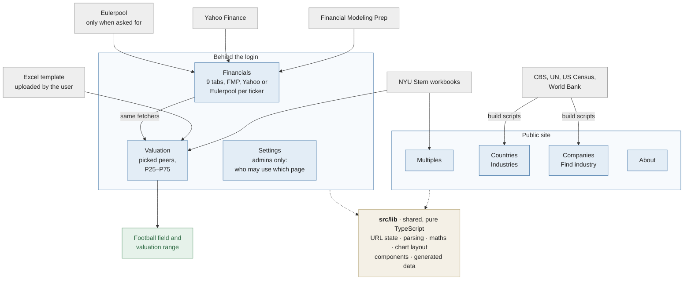
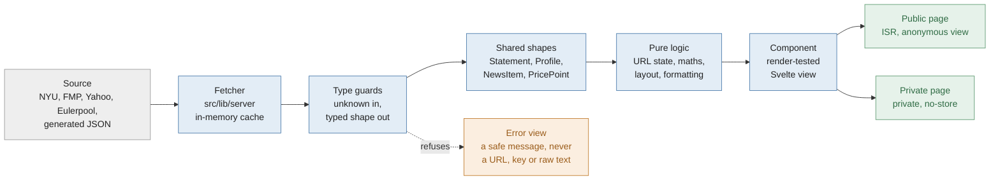

# my-svelte-app overview

> **The release PDF.** Every release carries `my-svelte-app-overview-<tag>.pdf` among its [assets](https://github.com/jan-ru/my-svelte-app/releases), built at the tag by `release-assets.yml` (`scripts/build-overview.ts`). This file holds its curated parts: §1 whole, an opening paragraph for each other page, the history from before the first release and the roadmap's *Later* column. The rest is generated at the tag: the decisions from `docs/adr/`, the releases from `CHANGELOG.md`, the quality figures from a run of the tests, and the roadmap's *Landed* and *Next* from merged PRs and open issues by their `lane:*` label. Each release PR reads this file against what changed ([RELEASING.md](../RELEASING.md), step 2).

## 1. The design at a glance

**In one sentence:** a SvelteKit app on Vercel that compares valuation multiples from the NYU Stern datasets in public, and behind Sign in with Google, page by page as an admin grants it, shows a company's financials and values it against peers.

Two pictures, drawn the way the `finance-tools` design page draws them: the landscape (external sources on top, the two parts of the site with their pages, the shared library below) and the canonical data flow every view follows. Both are simplified to the main components and flows.

### The landscape

Grey: an external source. Blue: a page. Green: an output. Beige: the shared library, which every page depends on (dashed) and which depends on nothing above it. The public pages are ISR-cached for a day and become interactive after login; the pages behind the login are private and never cached publicly.

### The data flow

Every view, public or private, runs the same chain from fetch to cached response:

Refuse rather than guess: a source that sends an unexpected shape, or lacks the period asked for, ends in a plain error message (a `SourceError` for FMP, Yahoo and Eulerpool), never a half-filled table or a mix of two sources. The source per ticker is decided once, in `src/lib/source.ts`, and query parameters outside the allow-list are dropped.

### The layers

| Layer | Where | What it does |
|---|---|---|
| Routes | `src/routes/` | Load data and render; the only place, with `hooks.server.ts`, that reads the environment |
| Pure logic | `src/lib/*.ts` | URL state, parsing, layout, maths and formatting: data in, data out, tested without mocks |
| I/O | `src/lib/server/` | NYU download and cache, FMP, Yahoo and Eulerpool clients, session and access rules |
| Components | `src/lib/components/` | Charts, tables and views, each with a render test |
| Data | `src/lib/data/` | Generated JSON with hand-written types |

### Principles

- **Effects at the edge.** Network, caches, cookies and environment reads stay in small functions at the outside; decisions are pure functions over `readonly` data. ([ADR-005](adr/0005-one-source-per-view.md), [ADR-007](adr/0007-strict-typescript.md))
- **The URL is the state.** Every view can be bookmarked and works without JavaScript. ([ADR-002](adr/0002-url-is-the-state.md))
- **Cheap in public, private where it costs.** Anonymous visitors get a cached default view; paid and licensed data stays behind the login. ([ADR-003](adr/0003-public-pages-isr-login-unlocks.md), [ADR-004](adr/0004-financials-private.md))
- **Refuse rather than mix.** One data source per view, allow-listed parameters, type guards on everything from outside. ([ADR-005](adr/0005-one-source-per-view.md))

## 2. Design decisions

Four ideas recur: effects at the edge, the URL as the state, cheap in public and private where it costs, and refuse rather than mix. The full log is in [docs/adr/](adr/README.md); the PDF groups the accepted decisions by theme and lists the superseded ones.

## 3. Release history

In under three weeks a starter app became a comparison tool with a private valuation page, on a design system; the releases since are weekly at most and curated in [CHANGELOG.md](../CHANGELOG.md). Before the first release, `2026.11.12`, the work went:

| When | Theme |
|---|---|
| 2024-11 to 2026-07 | Starter SvelteKit app; dependency updates only |
| 2026-10-24 | Rebuilt on SvelteKit 3: the multiples home page, NYU workbooks read live, CI |
| 2026-10-25 | Find industry and Companies pages; TypeScript only; security headers; the password-protected Financials page |
| 2026-10-26 to 27 | Financials tabs, TTM, profile, news, prices; Yahoo as a second source; the design system; the public static site |
| 2026-10-28 | Countries and Industries pages; Node LTS pin; the Explore menu and footer |
| 2026-10-30 | Ratios, Estimates, Earnings and Peers tabs; one loader registry and one component per view; TypeDoc |
| 2026-10-31 | The valuation page, its football-field chart and the private company template |
| 2026-11-01 | The six-point TypeScript review; lint and Prettier in CI; the second review round; one login page; inflation and real growth on Countries |
| 2026-11-02 to 04 | The design at a glance as diagrams; one shared source-failure message; Dependabot updates |
| 2026-11-08 | Eulerpool as a third source, with its fair value and quality score and the Supply chain tab |
| 2026-11-11 | The Horizon design system: tokens, grid, focus and shell, and shared components; the About and Company side menus; the condensed balance sheet; refactors; AGENTS.md |

## 4. Quality review

Types, lint, formatting, the TypeScript-only rule, the coverage floor and the dependency audit all fail CI; Lighthouse and the live NYU check run but do not block a merge. The weakest parts are the external sources: SheetJS outside Dependabot's reach and the unofficial Yahoo package. The PDF measures the figures at the tag; the health table, the six-point review and the watch list are in [docs/quality/](quality/README.md), and what runs at each stage in [docs/workflows.md](workflows.md).

## 5. Roadmap

What landed comes from the PRs merged since the previous release, what is next from the open issues, each placed in a lane by its `lane:*` label; an issue without one shows under *Unsorted*. *Later* is curated here, and its items are ideas, not commitments.

| Lane | Later |
|---|---|
| Valuation | DCF valuation as its own page |
| Financials | |
| Reference pages | |
| Design system | |
| Releases | |
