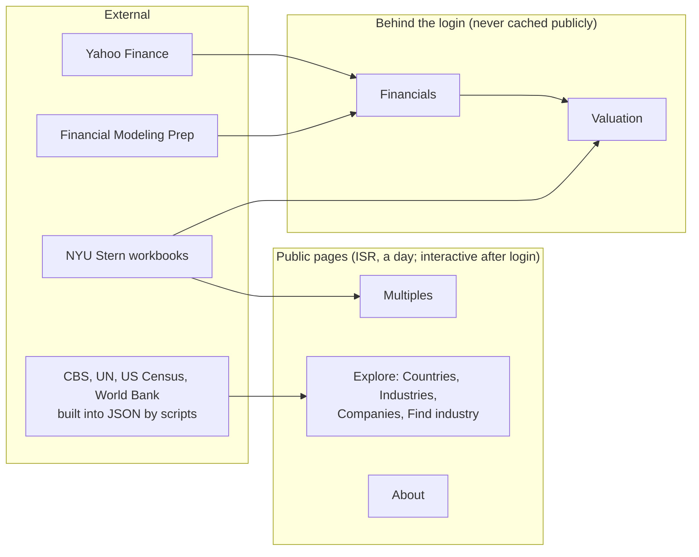

# my-svelte-app overview

> **Release:** none tagged yet; this overview describes `main` on 2026-11-01. Each release PR brings it up to date ([RELEASING.md](../RELEASING.md), step 3).

The same five parts as the `finance-tools` release overview: the design at a glance, design decisions, release history, quality review and roadmap.

## 1. The design at a glance

**In one sentence:** a SvelteKit app on Vercel that compares valuation multiples from the NYU Stern datasets in public, and behind a shared password shows a company's financials and values it against peers.

| Layer | Where | What it does |
|---|---|---|
| Routes | `src/routes/` | Load data and render; the only place, with `hooks.server.ts`, that reads the environment |
| Pure logic | `src/lib/*.ts` | URL state, parsing, layout, maths and formatting: data in, data out, tested without mocks |
| I/O | `src/lib/server/` | NYU download and cache, FMP and Yahoo clients, session and access rules |
| Components | `src/lib/components/` | Charts, tables and views, each with a render test |
| Data | `src/lib/data/` | Generated JSON with hand-written types |

**Principles**

- **Effects at the edge.** Network, caches, cookies and environment reads stay in small functions at the outside; decisions are pure functions over `readonly` data. ([ADR-005](adr/0005-one-source-per-view.md), [ADR-007](adr/0007-strict-typescript.md))
- **The URL is the state.** Every view can be bookmarked and works without JavaScript. ([ADR-002](adr/0002-url-is-the-state.md))
- **Cheap in public, private where it costs.** Anonymous visitors get a cached default view; paid and licensed data stays behind the login. ([ADR-003](adr/0003-public-pages-isr-login-unlocks.md), [ADR-004](adr/0004-financials-private.md))
- **Refuse rather than mix.** One data source per view, allow-listed parameters, type guards on everything from outside. ([ADR-005](adr/0005-one-source-per-view.md))

## 2. Design decisions

The full log is in [docs/adr/](adr/README.md). Grouped by theme:

| Theme | Decision | ADR |
|---|---|---|
| Data | Read the NYU workbooks live, cache them in memory, no database | [ADR-001](adr/0001-read-nyu-workbooks-live.md) |
| Data | Reference data is generated, committed as JSON and typed by hand | [ADR-006](adr/0006-typed-generated-json.md) |
| Data | A view never mixes data sources | [ADR-005](adr/0005-one-source-per-view.md) |
| Pages | The URL is the page state | [ADR-002](adr/0002-url-is-the-state.md) |
| Access | Public pages are a cached static view; the shared password makes them interactive | [ADR-003](adr/0003-public-pages-isr-login-unlocks.md) |
| Access | Company financials sit behind the login and are never cached publicly | [ADR-004](adr/0004-financials-private.md) |
| Valuation | Peers picked by hand, a P25–P75 range, private companies from an uploaded template | [ADR-008](adr/0008-valuation-peers-by-hand.md) |
| Code | TypeScript only, as strict as the tools allow, enforced in CI | [ADR-007](adr/0007-strict-typescript.md) |
| Code | One Node LTS line, pinned in four places a test keeps together | [ADR-009](adr/0009-node-lts-pin.md) |

## 3. Release history

No release is tagged yet; [CHANGELOG.md](../CHANGELOG.md) holds the work so far under *Unreleased*. In nine days a starter app became a comparison tool with a private valuation page:

| When | Theme |
|---|---|
| 2024-11 to 2026-07 | Starter SvelteKit app; dependency updates only |
| 2026-10-24 | Rebuilt on SvelteKit 3: the multiples home page, NYU workbooks read live, CI |
| 2026-10-25 | Find industry and Companies pages; TypeScript only; security headers; the password-protected Financials page |
| 2026-10-26 to 27 | Financials tabs, TTM, profile, news, prices; Yahoo as a second source; the design system; the public static site |
| 2026-10-28 | Countries and Industries pages; Node LTS pin; the Explore menu and footer |
| 2026-10-30 | Ratios, Estimates, Earnings and Peers tabs; one loader registry and one component per view; TypeDoc |
| 2026-10-31 | The valuation page, its football-field chart and the private company template |
| 2026-11-01 | The six-point TypeScript review; lint and Prettier in CI |

## 4. Quality review

Types, lint, formatting, the TypeScript-only rule, the coverage floor and the dependency audit all fail CI; Lighthouse and the live NYU check run but do not block a merge. The weakest parts are the external sources: SheetJS outside Dependabot's reach and the unofficial Yahoo package. Details, the six-point review and the watch list are in [docs/quality/](quality/README.md).

## 5. Roadmap

| Lane | Now | Next | Later |
|---|---|---|---|
| Valuation | Multiples against picked peers, listed or private | DCF valuation as its own page | |
| Financials | FMP and Yahoo, one source per view | Yahoo follow-ups from the review of #32 (#33) | |
| Design system | Tokens and global styles | Svelte components for repeated UI (#36) | |
| Releases | This document set | Tag the first release (`RELEASING.md`) | Build the overview at each tag automatically, as `finance-tools` does |

*Later* items are ideas, not commitments.
