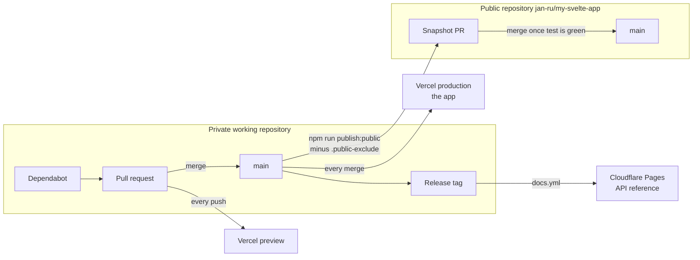

# Workflows

What runs automatically, grouped by the stage it belongs to. Each GitHub workflow carries its stage in its name: **CI (merge gate)**, **API docs (deploy)** and **NYU data check (scheduled)**. This page is read from `.github/workflows/`, `.github/dependabot.yml`, `vercel.json` and the repository rulesets; Vercel's dashboard settings are not covered.

## The four stages

| Stage | What runs | Defined in | Trigger | Blocks a merge? |
|---|---|---|---|---|
| **Development** (feedback while a branch is open) | `lighthouse` | `ci.yml` | PR, and push to `main` | No, on purpose: scores wobble on shared runners |
| | API docs build (TypeDoc warnings) | `docs.yml`, `build` job | PR that touches `src/lib/**` or the docs config | No |
| | Vercel preview deployment | Vercel Git integration, in the maintainer's private working repository | Every PR there | No |
| | The same commands on your machine | `package.json` scripts | You | n/a |
| **Merge gate** (must be green to merge) | `test` | `ci.yml` | PR, and again on push to `main` | **Yes**, the only required check |
| **Deployment** (publishes something after a merge) | Production deploy of the app | Vercel Git integration, in the private working repository; `vercel.json` holds only build commands | Every merge to its `main` | n/a |
| | API reference to Cloudflare Pages | `docs.yml`, `deploy` job, in the private repository | A release tag, or by hand | n/a |
| | Release: tag and GitHub pre-release | By hand, [RELEASING.md](../RELEASING.md) | You | n/a |
| **Scheduled** (runs on a clock, not on a change) | NYU data check | `check-data.yml` | Monthly on the 1st at 06:00 UTC, or by hand | n/a |
| | Dependency updates (npm and GitHub Actions) | `dependabot.yml`, in the maintainer's private working repository | Weekly, Mondays | n/a |

## The merge gate

The ruleset `Protect_main` requires a pull request and a passing `test` check, and the check is strict: the branch must be up to date with `main` before it can merge (switched on 2026-11-13). It asks for no approvals. Repository admins can bypass the ruleset (bypass mode "always"). A second ruleset, `Basic_Rules`, forbids deleting or force-pushing any branch.

Because the check is strict, the tree that merges is the tree `test` passed on. When another PR lands first, the branch has to be updated (the "Update branch" button, or `@dependabot rebase` on a Dependabot PR) and `test` runs again, about 2 minutes.

The `test` job runs these commands in order, and the same ones work locally:

```sh
npm run check          # svelte-check, strict
npm run lint           # typescript-eslint strictTypeChecked, eslint-plugin-svelte
npm run format:check   # Prettier
npm run check:ts-only  # no .js, .mjs, .cjs or .jsx
npm run test:coverage  # Vitest, with the coverage floor on src/lib
npm run build
npx playwright install --with-deps chromium
npm run test:e2e       # every page in Chromium, with and without JavaScript, and axe
npm audit --omit=dev --audit-level=high
```

A failed run uploads the Playwright report as an artifact for 7 days.

## Deployment

Where each part goes, and from which repository ([ADR-010](adr/0010-develop-privately-publish-snapshots.md)):



- **The app** is deployed by Vercel, not by a workflow, from the private working repository: every merge to its `main` goes to production and every PR there gets a preview. The public repository deploys nothing; its snapshot PRs carry no Vercel checks. Where Vercel checks appear on a PR, none of them is required.
- **The API reference** goes to Cloudflare Pages (<https://my-svelte-app-docs.pages.dev/>) at a release tag, or by hand from `main` or a tag. A pull request that touches `src/lib/**`, `typedoc.json`, `tsconfig.json`, `package.json`, `package-lock.json` or `docs.yml` itself only builds it. Deployments run one at a time and a newer one waits for a running one.
- **The public repository receives snapshots.** Development happens in a private working repository; its `main` is copied to the public one as one commit per snapshot, through a pull request that `test` checks like any other. Some files (agent configuration, design sources, the release procedure, the Dependabot config) exist only there. The API reference (`docs.yml`) is built and published from the private repository only.
- **A tag deploys only the API reference.** The app itself is not rebuilt for a release ([RELEASING.md](../RELEASING.md)).

## Things to know

- Nothing in the repository makes Vercel wait for CI. A merge deploys even if the run of `test` on `main` afterwards fails; that second run is a signal after the fact, not a gate. With the check strict it should only fail for a reason the tree does not explain, such as a flaky test or a new advisory in `npm audit`.
- `npm audit` is part of `test` but its result depends on the day, not on the change: a new advisory in a runtime dependency fails every open PR until it is handled.
- The ruleset binds to the job name `test`. If the job is renamed or split, keep a final job called `test` or change the ruleset in the same PR, or every PR waits for a check that never reports.
- Changing `docs.yml` triggers the API docs workflow, because the file is in its own path filter.
- Actions are pinned by commit SHA with the version in a comment; Dependabot moves both together.
