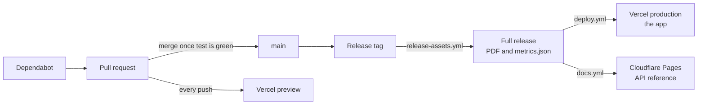

# Workflows

What runs automatically, grouped by the stage it belongs to. Each GitHub workflow carries its stage in its name: **CI (merge gate)**, **API docs (deploy)**, **App production deploy (deploy)**, **Release assets (deploy)** and **NYU data check (scheduled)**. This page is read from `.github/workflows/`, `.github/dependabot.yml`, `vercel.json` and the repository rulesets; Vercel's dashboard settings are not covered.

## The four stages

| Stage | What runs | Defined in | Trigger | Blocks a merge? |
|---|---|---|---|---|
| **Development** (feedback while a branch is open) | `lighthouse` | `ci.yml` | PR, and push to `main` | No, on purpose: scores wobble on shared runners |
| | API docs build (TypeDoc warnings) | `docs.yml`, `build` job | PR that touches `src/lib/**` or the docs config | No |
| | Vercel preview deployment | Vercel Git integration | Every PR | No |
| | The same commands on your machine | `package.json` scripts | You | n/a |
| **Merge gate** (must be green to merge) | `test` | `ci.yml` | PR, and again on push to `main` | **Yes**, the only required check |
| **Deployment** (publishes something from a release) | Release: the tag, by hand ([RELEASING.md](../RELEASING.md)); then the overview PDF, `metrics.json` and the full release, made by the shared workflow of jan-ru/.github | `release-assets.yml`, calling `jan-ru/.github/.github/workflows/release.yml` | A release tag, or by hand for a tag (`dry_run` on by default) | n/a |
| | Production deploy of the app to Vercel | `deploy.yml`, called by `release-assets.yml` after the release | A release, or by hand for a release tag (a rollback) | n/a |
| | API reference to Cloudflare Pages | `docs.yml`, `deploy` job, called by `release-assets.yml` after the release | A release, or by hand | n/a |
| | Overview PDF preview | `release-assets.yml`, `build` job | PR that touches the overview's inputs | No |
| | `metrics.json` for jan-ru/system-health | `ci.yml`, `metrics` job | Every push to `main`, after `test` and `lighthouse` | n/a |
| **Scheduled** (runs on a clock, not on a change) | NYU data check | `check-data.yml` | Monthly on the 1st at 06:00 UTC, or by hand | n/a |
| | Dependency updates (npm and GitHub Actions) | `dependabot.yml` | Weekly, Mondays | n/a |

## The merge gate

The ruleset `Protect_main` requires a pull request and a passing `test` check, and the check is strict: the branch must be up to date with `main` before it can merge (switched on 2026-11-13). It asks for no approvals, and nobody can bypass it, admins included (the bypass was removed on 2026-11-23, as in cap-tools): the shared release workflow's guard relies on every merge to `main` having passed `test`. A second ruleset, `Basic_Rules`, forbids deleting or force-pushing any branch.

Because the check is strict, the tree that merges is the tree `test` passed on. When another PR lands first, the branch has to be updated (the "Update branch" button, or `@dependabot rebase` on a Dependabot PR) and `test` runs again, about 2 minutes.

The `test` job runs these commands in order, and the same ones work locally:

```sh
npm run check          # svelte-check, strict
npm run lint           # typescript-eslint strictTypeChecked, eslint-plugin-svelte
npm run format:check   # Prettier
npm run check:ts-only  # no .js, .mjs, .cjs or .jsx
npm run test:coverage  # Vitest, with the coverage floor on src/lib
npm run build
npx playwright install --with-deps chromium
npm run test:e2e       # every page in Chromium, with and without JavaScript, and axe
npm audit --omit=dev --audit-level=high
```

A failed run uploads the Playwright report as an artifact for 7 days.

## Deployment

Where each part goes:



- **The app** goes to production only from a release ([jan-ru/.github ADR-0001](https://github.com/jan-ru/.github/blob/main/docs/adr/0001-releases-from-one-shared-workflow.md) part 7). `deploy.yml` checks that the tag has a full release, uploads the tag's source and lets Vercel build it with the project's own environment variables; `vercel.json` turns off Vercel's own deploys of `main` (`git.deploymentEnabled`). Every PR still gets a preview from the Vercel Git integration; those checks appear on a PR, but none is required. The deploy needs the repository secrets `VERCEL_TOKEN`, `VERCEL_ORG_ID` and `VERCEL_PROJECT_ID`. A rollback is `deploy.yml` run by hand for an earlier release tag.
- **The API reference** goes to Cloudflare Pages (<https://my-svelte-app-docs.pages.dev/>) after a release, or by hand for a tag or a branch. A pull request that touches `src/lib/**`, `typedoc.json`, `tsconfig.json`, `package.json`, `package-lock.json` or `docs.yml` itself only builds it. Deployments run one at a time and a newer one waits for a running one.
- **A tag builds the release assets; the release then deploys the app and the API reference.** A tag the shared workflow refuses deploys nothing ([RELEASING.md](../RELEASING.md)).
- **One repository.** For one day (2026-11-19) development ran in a private copy that published snapshots here; that was undone the same day ([ADR-011](adr/0011-one-public-repository.md)).

## Metrics for system-health

jan-ru/system-health collects one `metrics.json` per repository (its ADR-0002: it pulls the file, nothing here pushes). On every push to `main`, the `metrics` job in `ci.yml` runs after `test` and `lighthouse`, whatever their result. `scripts/build-metrics.ts` builds the file from the reports those jobs kept, using `src/lib/metrics.ts`, and the job uploads it as the artifact `metrics` for 90 days. The format is system-health's `schema/metrics.v1.schema.json`. A field that was not measured is left out, never written as 0:

| Field | From |
|---|---|
| `quality.coverage_pct` | Vitest line coverage of `src/lib` (`coverage/coverage-summary.json`); left out when a unit test failed |
| `quality.tests` | Vitest plus Playwright; a test that passed on retry counts as passed |
| `quality.type_errors`, `quality.lint_errors` | `0` when `npm run check` or `npm run lint` passed (both fail on any error); left out when they failed |
| `security.vulnerabilities` | `npm audit --package-lock-only` over every dependency, the same scope cap-tools reports, so the counts compare. The `test` gate itself audits runtime dependencies only |
| `performance.lighthouse` | The Lighthouse scores of the home page `/` from the `lighthouse` job |
| `gates` | `test`, the one required check |

The steps that keep reports and the `metrics` job run only in `jan-ru/my-svelte-app`, not in forks.

## Things to know

- A merge to `main` deploys nothing. Production changes only when a release is cut, and the release's guard requires the merged PR to have passed `test`.
- `npm audit` is part of `test` but its result depends on the day, not on the change: a new advisory in a runtime dependency fails every open PR until it is handled.
- The ruleset binds to the job name `test`. If the job is renamed or split, keep a final job called `test` or change the ruleset in the same PR, or every PR waits for a check that never reports.
- Changing `docs.yml` triggers the API docs workflow, because the file is in its own path filter.
- Actions are pinned by commit SHA with the version in a comment; Dependabot moves both together.
